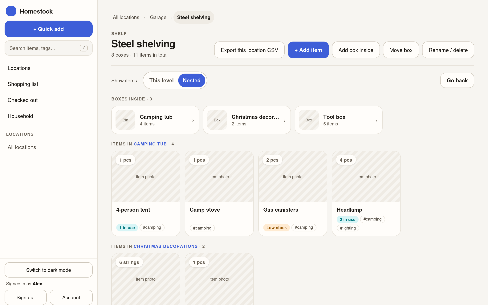
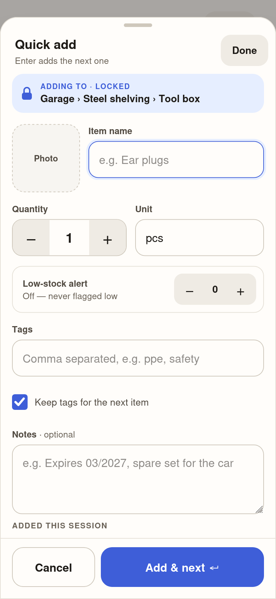
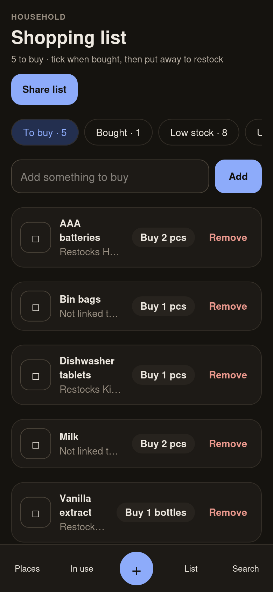
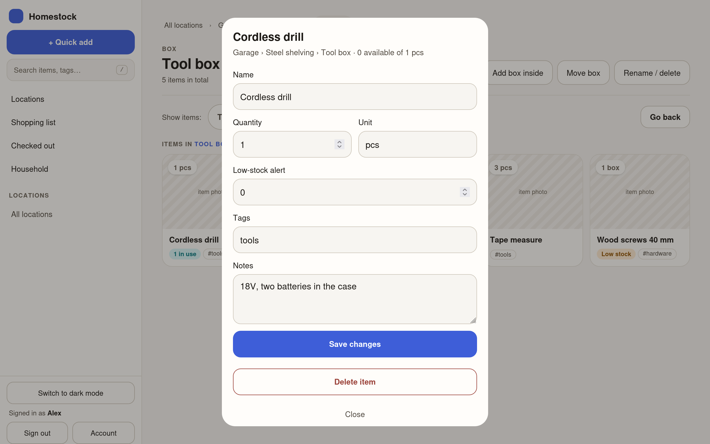
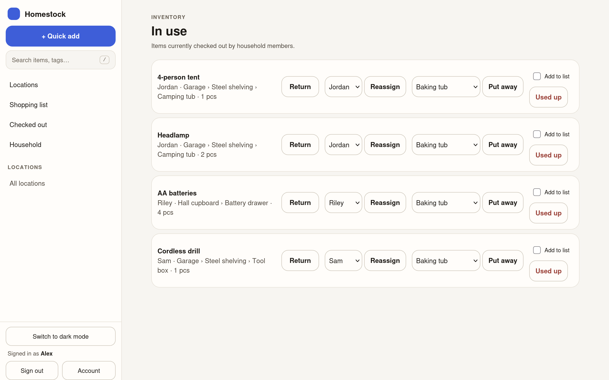
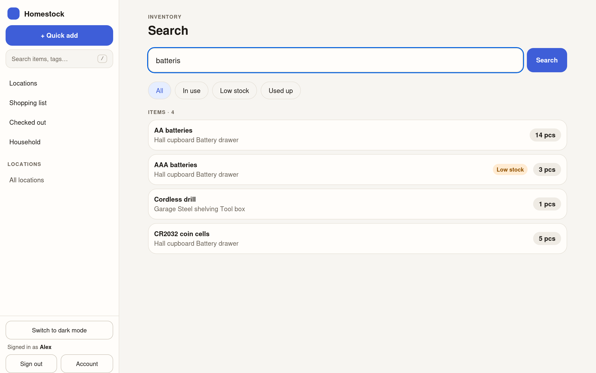

# Homestock

**A self-hosted home inventory for your household.** Homestock answers three questions about
anything you own: *where is it, how many are left, and who has it?* It runs on a small server on
your home network (a Proxmox container, a mini PC or a Raspberry Pi) and works on phones,
tablets and desktops. Your data stays at home, and nothing is sent to the cloud.

<p align="center">
  
</p>

## What it does

- **Organised the way your home is.** Rooms hold cupboards, shelves and boxes, which hold more
  boxes, as deep as you like. Open any box to see what's in it, and optionally everything nested
  inside it too.
- **Quick add for unpacking a box.** Lock the box you're filling and add one thing after another,
  each with an optional photo, tags and notes, without leaving the form.
- **Check things out.** Record who borrowed what and how many, then return it, put it away
  somewhere else, hand it to someone else, or mark it used up.
- **Low stock and a shopping list.** Set an alert level on anything you run out of. Low and
  used-up items feed a shared shopping list, and ticking something as bought and putting it away
  restocks it. Share the list as text to take to the shop.
- **Find things fast.** Search by name, notes, tag or location. It tolerates typos.
- **Household accounts.** Each person signs in with their own account, and admins manage the
  household. There's light and dark mode, CSV export, and drag and drop for moving boxes on a
  desktop.
- **Looks after its data.** Automatic database backups when the house is quiet, with an
  optional copy to a NAS. Upgrades back up first and roll back if anything goes wrong.

## Screenshots

| | |
|---|---|
|  |  |
| Quick add on a phone, locked to the box being filled | The shopping list in dark mode |



*Item details, opened over the box it lives in.*



*Everything currently checked out, and who has it.*



*Search still finds the batteries, typo and all.*

## Get started

Homestock runs as a single Docker container on any 64-bit Linux machine, **x86-64 or ARM64**.
The installer sets up everything else, including Docker itself on Debian and Ubuntu:

```sh
curl -fsSLO https://github.com/ntyndall1/homestock/releases/latest/download/install.sh
sudo bash install.sh
```

**[Quickstart guide](docs/QUICKSTART.md):** the requirements and every step from a fresh
machine to your first sign-in.

More guides:

- [Running Homestock in a Proxmox LXC](docs/PROXMOX-LXC.md): creating the container and the
  features it needs.
- [Putting Homestock behind HAProxy](docs/HAPROXY.md): a trusted certificate and a friendly
  address, using HAProxy on OPNsense.
- [Administration](docs/ADMINISTRATION.md): upgrades, account recovery, backups and the NAS
  copy, health checks.

## How it's built

Homestock is a Rust ([Axum](https://github.com/tokio-rs/axum)) web server with server-rendered
pages ([HTMX](https://htmx.org/)) and a [SQLite](https://sqlite.org/) database. It ships as one
small container image that makes no external requests at runtime. Release images are built for
amd64 and arm64 and signed with [Sigstore cosign](https://docs.sigstore.dev/), and the installer
checks the signatures before running anything.

To work on Homestock, see [docs/IMPLEMENTATION.md](docs/IMPLEMENTATION.md) for the architecture
and for running it locally with `cargo`. The release process is described in
[deploy/README.md](deploy/README.md).
